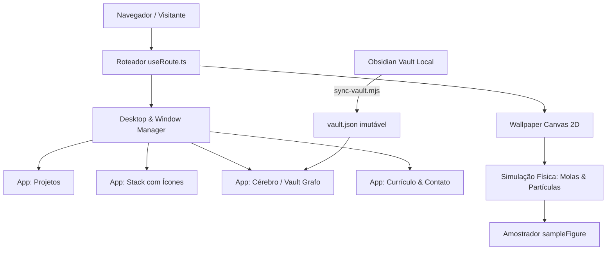

# gabriel.os — Web Operating System & Portfólio Pessoal

<div align="center">

[](https://gabrielarantessilva.com)
[](https://react.dev)
[](https://www.typescriptlang.org)
[](https://tailwindcss.com)
[](https://vitest.dev)

<p align="center">
  <strong>Simulador de Sistema Operacional de Alta Densidade no Navegador</strong><br>
  Projetado para engenheiros, tech leads e recrutadores explorarem projetos, arquiteturas e o Segundo Cérebro (Obsidian) sem fricção.
</p>

</div>

---

## 🎯 Motivo da Criação

A esmagadora maioria dos portfólios de desenvolvedores segue a mesma fórmula saturada: landing pages com rolagem infinita, cards estáticos e pouca densidade de informação técnica real.

O **`gabriel.os`** nasceu para romper essa barreira:
- **Uma intranet pessoal aberta**: reunir em um único ambiente navegável todos os sistemas em produção, notas de arquitetura e histórico de código.
- **Engenharia de precisão visual**: demonstrar domínio avançado de front-end, renderização gráfica em tempo real com Canvas 2D, animações baseadas em física e gestão modular de janelas.
- **Tensão Intranet vs. Portfólio resolvida**: recrutadores que têm apenas 30 segundos conseguem acessar o resumo executivo, stack e contatos no primeiro boot; já tech leads curiosos podem abrir janelas, explorar o grafo do vault e inspecionar os commits e rotas com profundidade.

---

## 💡 O que Soluciona

| Problema Convencional | Solução no `gabriel.os` |
| :--- | :--- |
| **Portfólios lentos ou vazios** | Janelas abertas de saída (`sobre` e `projetos`) já povoadas na inicialização, sem exigir cliques para descoberta inicial. |
| **Perca de contexto no mobile** | A metáfora desktop se transforma em pilha de cards em tela cheia com barra de navegação ergonômica inferior no celular. |
| **Links inacessíveis/não compartilháveis** | Cada aplicação possui sua própria rota (`/projetos`, `/stack`, `/cerebro`), mantendo o botão "Voltar" do navegador 100% funcional. |
| **Reivindicações sem lastro técnico** | Dados sincronizados diretamente do cofre Obsidian local (330 notas) e dos repositórios git ativos. |

---

## 🏗️ Arquitetura & Decisões Técnicas



1. **Roteador Sem Dependências (`useRoute.ts`)**:
   - Zero overhead de bibliotecas pesadas de roteamento: usa a API nativa `history.pushState` e `popstate` para sincronizar o app ativo com a URL.
2. **Motor Gráfico de Partículas em Canvas 2D (`Wallpaper.tsx` & `figures.ts`)**:
   - Simulação de malha com física de molas (`Spring Physics`) subamortecida.
   - Algoritmo de amostragem que preserva 100% dos vértices de figuras geométricas (Monograma GA, átomo React, cubo isométrico, terminal, etc.).
   - Suporte a mais de 260 partículas simultâneas no desktop e densidade adaptativa para dispositivos móveis.
3. **Pipeline de Ingestão Estática (`scripts/sync-vault.mjs`)**:
   - Transforma centenas de notas markdown em um grafo estático otimizado (`vault.json`) em tempo de build, garantindo latência zero na navegação.

---

## 🛠️ Stack Tecnológica

- **Core**: React 19, TypeScript, Vite 8.
- **Estilização & UI**: Tailwind CSS v4, JetBrains Mono & Inter fonts, Lucide React, ícones vetoriais customizados.
- **Animações & Canvas**: Framer Motion, HTML5 Canvas 2D com física determinística.
- **Testes & Qualidade**: Vitest, React Testing Library, Oxlint.
- **Deploy & Infra**: Vercel Edge Network com domínio próprio customizado.

---

## 🚀 Como Rodar Localmente

```bash
# 1. Clone o repositório
git clone https://github.com/GabrielArantesSilva/my-portfolio.git
cd my-portfolio

# 2. Instale as dependências
npm install

# 3. Inicie o servidor de desenvolvimento
npm run dev

# 4. Executar suíte de testes
npm test

# 5. Typecheck & Lint
npm run typecheck
npm run lint

# 6. Build de Produção
npm run build
```

---

## 🌐 Produção

- **URL Oficial:** [https://gabrielarantessilva.com](https://gabrielarantessilva.com)
- **Autor:** [Gabriel Arantes Silva](https://github.com/GabrielArantesSilva)
